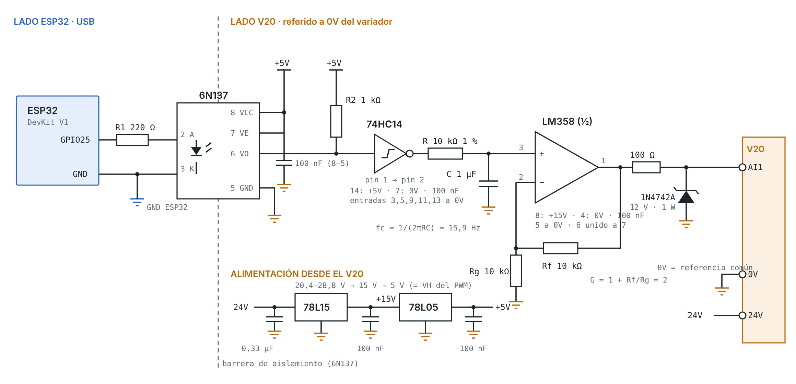

# Control de velocidad del SINAMICS V20 con ESP32

Laboratorio N.º 2 · Electrónica de Potencia · Universidad del Magdalena (2026-II)
Docente: Ing. Jordan Dallan Guillot Fula
Autores: [nombre, código] · [nombre, código]

Un ESP32 genera la consigna 0–10 V de la entrada AI1 del V20 con un PWM de 20 kHz aislado por un 6N137, filtrado y amplificado. Esto reemplaza el potenciómetro. La extensión IoT agrega mando desde el celular (marcha, paro, sentido, reset y consigna), lectura del estado del V20 y corriente de una fase del motor con un ACS712.

**App móvil:** https://USUARIO.github.io/Lab2-V20-ESP32/ (GitHub Pages, carpeta `docs/`)

## Contenido
| Carpeta | Qué hay |
|---|---|
| `firmware/consigna_pwm_v20/` | Firmware de la guía (v2): consigna por monitor serie |
| `firmware/v20_iot_esp32/` | Firmware IoT (v3.2): consigna + PC817 a DI1–DI3 y DO1 + DO1/DO2 + ACS712 + MQTT |
| `docs/esquematico/` | Esquemático completo (SVG, PNG, PDF con lista de materiales) |
| `pcb/` | PCB una cara: PDF 1:1 para planchado, Gerber, netlist y verificador |
| `docs/index.html` | App web (MQTT sobre WebSocket, sin librerías) |
| `docs/Hoja_Laboratorio_Lab2.pdf` | Cableado del acondicionador, pruebas en banco y tablas |
| `docs/Guia_Conexiones_V20_IoT.pdf` | Cableado IoT pin a pin, parámetros del V20, protecciones |
| `calculos/` | Memoria de cálculo (fc, rizado, resolución, tolerancias) |
| `analisis/` | Script que genera las gráficas y errores desde las tablas medidas |
| `sim/` | Simulación: firmware real + modelo del V20 y motor + broker MQTT + app (30/30 pruebas) |
| `wokwi/` | Proyecto para simular en wokwi.com con el V20 simulado y la app (ver LEEME_WOKWI.txt) |
| `informe/` | Informe IEEE (borrador con la ampliación IoT; generar con `node build_informe_v3.js`) |

## Valores de diseño
| Magnitud | Valor |
|---|---|
| Escala | V_AI1 = 10·D V → f = 60·D Hz |
| Frecuencia de corte RC | 15,9 Hz |
| Rizado máximo (D = 0,5) | 12,5 mVpp ≈ 0,075 Hz |
| Resolución (10 bits) | 9,8 mV ≈ 0,059 Hz |
| Establecimiento | 50 ms |

## Parámetros del V20
- **Guía:** P0700 = 1 · P1000 = 2 · P0756 = 0 · P0757 = 0 · P0758 = 0 · P0759 = r0752 a 60 Hz · P0760 = 100 · P2000 = 60
- **Modo IoT (adicional):** P0700 = 2 · P0701 = 1 · P0702 = 12 · P0703 = 9 · P0731 = 52.2 · P0732 = 52.3

## Compilar
Arduino IDE, placa "ESP32 Dev Module", librería PubSubClient. Para el firmware IoT, cree `credenciales.h` a partir de `credenciales_ejemplo.h`. Ese archivo no se sube al repositorio.

## Resultados
[Completar con las Tablas 1 a 3 medidas en el banco.]
